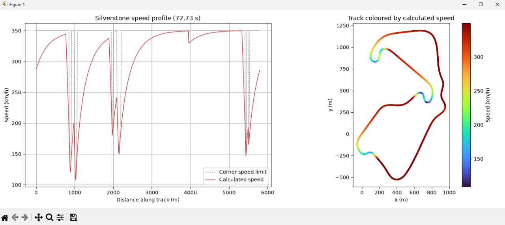

# Silverstone Lap Time Simulator

A Python-based simulation of Formula 1 lap performance at the Silverstone Circuit, using track geometry to estimate a speed profile and calculate lap time.

## Description

This project simulates a Formula 1 car completing a lap of the Silverstone Circuit. Instead of assuming a constant speed throughout the lap, the model uses track geometry to estimate how the car's speed changes along the circuit.

The simulation loads raceline data from a CSV file and calculates the curvature of the track at different points. Track curvature is used to estimate the speed the car can maintain through different sections of the circuit, reflecting the relationship between cornering speed and the sharpness of each turn.

Based on the calculated curvature, the script generates a cyclic speed profile representing a complete lap. This profile is then used to estimate the total lap time, illustrating how the layout of the circuit can influence overall performance.

The project also produces a visualization of the simulation results, providing a way to examine the relationship between track geometry and the estimated speed profile.

**Note:** This is a simplified simulation model intended for educational and exploratory purposes. The calculated speed profile and lap time depend on the input raceline data and the assumptions implemented in the model. They should not be interpreted as official Formula 1 telemetry or an exact prediction of real-world lap performance.

## Technologies Used

- **Python** — core simulation and calculations
- **NumPy** — numerical operations and track geometry calculations
- **Pandas** — loading and processing raceline data from CSV files
- **Matplotlib** — visualizing simulation results

## Requirements

- Python 3
- NumPy
- Pandas
- Matplotlib
- Silverstone raceline data in CSV format

## Usage

1. Download or clone this repository.
2. Install the required Python libraries.
3. Ensure that the Silverstone raceline file is available at `racetrack-database/racelines/Silverstone.csv`.
4. Run `main.py` in Python or PyCharm.
5. The script processes the track geometry, generates a speed profile, and calculates the estimated lap time.
6. The simulation visualization can be viewed in the image included in this repository.

## Simulation Results

The image below shows a visualization associated with the Silverstone lap simulation.

## Project Structure

- `main.py` — main simulation script
- `racetrack-database/racelines/Silverstone.csv` — input raceline data
- `silverstone-lap-sim.jpg` — simulation image included in the repository

## Future Improvements

Potential extensions include incorporating vehicle acceleration and braking limits, tire grip, aerodynamic downforce, and more detailed vehicle dynamics to make the simulation more representative of real-world Formula 1 performance.
